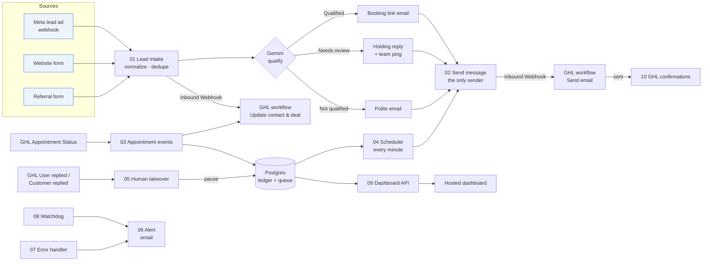

# Speed-to-Lead Revenue Engine

*n8n + GoHighLevel + Gemini · built with Claude Code*

A B2B agency (Northwind Growth, the example client) gets leads from Meta ads, its
website and referrals. Before this system, replies took hours, about half of booked calls
no-showed, and nobody knew what a booked call cost. With it, every lead gets a reply in about
about 15 seconds. Gemini qualifies each lead, qualified leads get a booking link, and the system
reminds and chases them. The owner gets a one-screen scorecard showing which source brings
the cheapest booked calls.

| Deliverable | Where |
|---|---|
| n8n workflows (exported JSON) | [`workflows/`](workflows/) (10 files, import in n8n) |
| GoHighLevel workflows | 5 workflows built in GHL Automation, described [below](#the-5-gohighlevel-workflows) |
| Live dashboard | GitHub Pages: `https://sirineghader-dotcom.github.io/sirine-portfolio/speed-to-lead/dashboard/` |
| Ad spend sheet | [`data/ad-spend.csv`](data/ad-spend.csv) |
| Database schema | [`sql/schema.sql`](sql/schema.sql) |
| Proof the guarantees hold | [`scripts/test_guarantees.py`](scripts/test_guarantees.py) (24 checks against real Postgres) |
| Test-lead simulator (for the Loom) | [`scripts/simulate.sh`](scripts/simulate.sh) |
| Loom script | [below](#loom-script), with diagrams in [`diagram.html`](diagram.html) |

---

## How it works



GoHighLevel is the CRM the team works in. n8n holds the logic and a small Postgres
database holds the system's memory, which is what makes the hard guarantees hold.

**n8n talks to GoHighLevel through GHL's own Automation, not an API token.** The GHL
sub-account is shared and does not allow Private Integration tokens, so n8n posts to two
GHL workflows that start with an *Inbound Webhook* trigger, and GHL workflows post events
back to n8n with *Webhook* actions. GHL does the CRM clicks (contact, tags, deal stage,
sending the email); n8n decides what should happen and when.

| n8n workflow | What it does |
|---|---|
| `01-lead-intake` | Three webhooks (Meta, website, referral), each tagged with its source. Normalizes the data, dedupes, asks GHL to create the contact and deal, asks Gemini to qualify, asks GHL to move the deal and sends the first reply. Also schedules the booking chase. |
| `02-send-message` | Sub-workflow and the **only** place that messages a lead. Reserves the send in a ledger first, refuses if a human has taken over, then hands the email to GHL. |
| `03-appointment-events` | GHL calendar events. Works out whether each one is a booking, reschedule, cancellation, no-show or show; moves the deal; kills old reminders; queues new ones. |
| `04-scheduler` | Every minute: claims due reminders, chases and re-books, re-checks each one is still valid, then sends it. |
| `05-human-takeover` | A team member's reply (GHL *User replied*) pauses all automation for that lead. A STOP reply from the lead does the same. Any other lead reply pings the team. |
| `06-alert` | Sub-workflow: records the alert, then emails it (and posts to Slack if configured). |
| `07-error-handler` | n8n error workflow for every other workflow: any crash becomes an alert. |
| `08-watchdog` | Every 5 minutes: finds problems that never threw an error (a lead with no reply after 5 min, a stalled scheduler, an email GHL never confirmed, a review waiting over 2 hours). Pings a dead-man's switch. |
| `09-dashboard-api` | Anonymised per-source data (no names or emails) for the dashboard. |
| `10-ghl-ack` | GHL's "email sent" callback. A message only counts as sent, and the reply time is only stamped, when GHL confirms it. |

### The 5 GoHighLevel workflows

All in the folder **SG - Speed to Lead** in GHL Automation.

| GHL workflow | Trigger | Actions |
|---|---|---|
| SG STL · Update contact & deal | Inbound Webhook (from n8n) | Create/update contact (name, email, company, source, `SG-Lead Score`, `SG-Qualification`, `SG-Qualification Reason`, `SG-Lead Source`) → add the source tag → add the extra tag (AI label or `human-takeover`) → If/Else on `stage` → Create/update opportunity in that stage of **SG- Speed to lead** |
| SG STL · Send email | Inbound Webhook (from n8n) | Create/update contact → Send Email (subject and HTML body written by n8n) → Webhook to n8n `/stl/ghl-ack` with `dedupe_key` |
| SG STL · Appointment → n8n | Appointment Status (calendar *SG Free Consultation*) | Webhook to n8n `/stl/appointment` |
| SG STL · Team replied → n8n | User replied | Webhook to n8n `/stl/message`, custom data `kind = human_reply` |
| SG STL · Lead replied → n8n | Customer replied | Webhook to n8n `/stl/message`, custom data `kind = lead_reply` |

Leads are matched by email: it is the key GHL uses to find contacts, and the key n8n uses
in its own tables.

---

## The real work, and how each case is handled

### 1. The same event can arrive 3 times, and nobody gets the same message twice

Two independent locks:

- **Event gate.** Every webhook gets a deterministic key: the Meta `leadgen_id`, the form
  submission id, or `appointmentId + status + startTime`. The first step inserts that key
  into `processed_events` with `INSERT … ON CONFLICT DO NOTHING`. Postgres guarantees exactly
  one execution gets `is_new = true`, even when the 3 copies arrive in the same millisecond.
  The copies are counted (`hits`) and stop.
- **Send ledger.** Every message has a dedupe key (`lead:template`, or
  `appointment:version:template`). `02-send-message` reserves that key in `sent_messages`
  *before* it hands the email to GHL, so a second attempt cannot send. If GHL errors, the
  message is not retried automatically, because GHL may have sent it before timing out.
  Instead the team gets an alert.
- Webhooks answer `200` immediately, so Meta and GHL have no reason to retry.

### 2. A reschedule or cancel kills the old reminders

- Each appointment has a `version` that goes up whenever its start time changes. Reminders
  are queued as rows tied to `(appointment_id, version)`.
- A reschedule or cancel marks every pending reminder for that lead as `cancelled`, then
  queues new ones for the new version.
- Right before sending, the scheduler checks again that the row's version is still current
  and the appointment is still booked. A reminder for the old time cannot go out, even if
  it was mid-flight during the reschedule.
- An event older than the last one applied is ignored, so out-of-order webhooks are safe.

### 3. A human reply stops all automation for that lead

- GHL's **User replied** trigger fires only when a person on the team replies to a contact,
  never for workflow emails. Its GHL workflow tells n8n, which sets `automation_paused` on
  the lead, cancels the queue, has GHL tag the contact `human-takeover` and tells the team.
- Every send re-checks the pause inside the same SQL statement that reserves it, so nothing
  queued earlier can slip out.
- A reply of STOP (or unsubscribe, end, quit) from the lead pauses it the same way.

### 4. Every failure alerts you. No silent errors

- **Crashes:** every workflow names `07-error-handler` as its error workflow, which sends
  an email with a link to the failed execution.
- **Soft failures:** a failed Gemini call parks the lead in Needs Review and still sends a
  reply, then alerts. If GHL refuses a message, the ledger records it and an alert goes out.
  A lead without an email or phone also triggers an alert.
- **Silent failures:** an email counts as sent only when GHL's *Send email* workflow calls
  back. If that confirmation never comes, the watchdog alerts after 10 minutes. It also
  alerts when a lead has had no reply after 5 minutes and when sends are overdue (the
  scheduler is down). Each problem alerts once, not every 5 minutes.
- **n8n itself down:** the watchdog pings a Healthchecks.io check every 5 minutes. If the
  pings stop, Healthchecks emails you.
- Alert targets are written into the Alert workflow itself, so alerts still go out when
  the database is down.

Run `python3 scripts/test_guarantees.py` to see all of this pass against real Postgres,
using the SQL read straight out of the workflow files:

```
PASS same lead event x3 is processed once  [is_new=[True, False, False], hits=3]
PASS 3 simultaneous copies: exactly one wins
PASS first reply reserved once out of 3 attempts
PASS a repeated GHL confirmation changes nothing
PASS an email GHL never confirms raises an alert
PASS booking event x3 handled once
PASS reschedule kills old reminders, queues new ones
PASS out-of-order old event is ignored
PASS scheduler refuses reminders for the old time
PASS after takeover, even a brand-new message is refused
PASS watchdog flags a lead with no reply after 5 min
PASS the same alert is delivered once, not every 5 minutes
...
24/24 guarantees hold
```

### Tested live

All of it was also run end to end in the real n8n and GoHighLevel accounts:

| Case | What happened |
|---|---|
| Meta lead | Gemini: qualified · 95; contact and deal created in GHL; booking-link email in the inbox **16 seconds** after opt-in |
| Same lead sent 3 times at once | event seen 3 times, processed once: 1 lead, 1 email |
| Booked through the email link | deal → Call Booked, confirmation email, reminders queued, chase cancelled |
| Rescheduled in GHL | appointment version 2, the 2 old reminders cancelled, 2 new ones queued, deal → Call Rescheduled |
| Cancelled, then booked again | reminders killed, re-book email sent, re-book sequence stopped by the new booking |
| Marked no-show | deal → No-Show-Re-book, 3-step re-book sequence queued |
| Team member replied in GHL | automation paused, queue cancelled, `human-takeover` tag, alert email |
| Lead with no email or phone | alert email |

---

## My calls

### Ideal client and qualification rules

The ideal client is a **B2B** company (services, SaaS, professional services) with
**10 to 200 employees**. It spends **$5,000 or more a month** on marketing, the person
filling in the form is a **decision maker**, and it wants to start within **90 days**.

Gemini (`gemini-3.5-flash-lite` on the free tier, JSON-schema output) scores each lead from 0 to 100
on five weighted factors: business model fit 30, size 20, budget 25, authority 15 and
timeline 10. It returns a label, the score and a one-line reason. The full rules are in
[`prompts/qualification-system-prompt.md`](prompts/qualification-system-prompt.md).

| Result | Rule | What happens |
|---|---|---|
| Qualified | score ≥ 70, no disqualifier | booking link by email within seconds, chase at +4h, +1d, +3d |
| Needs review | 40 to 69, budget $2k to $5k, 500+ staff, missing or odd answers, or AI unavailable | short holding reply, team pinged, watchdog nags after 2h |
| Not qualified | score < 40, or B2C, job seeker, vendor, budget under $2k | one polite email, deal marked lost |

Code then enforces the rules after Gemini answers. A "qualified" label with a score under
70 is downgraded to Needs Review. Form answers are passed as data, so text in a form field
can't change the rules.

### Channels and timings

| Moment | Channel | Timing |
|---|---|---|
| First reply | SMS (fast) + email (has the link) | within ~1 minute of opt-in |
| Booking chase | SMS, email, SMS | +4 hours, +1 day, +3 days. Stops when booked |
| Booking confirmed / rescheduled | SMS + email | immediately |
| Reminders | email + SMS, then SMS | 24 hours and 2 hours before the call |
| Cancelled | SMS, then email | immediately, then +2 days |
| No-show re-book | SMS, email, SMS | +15 minutes, +1 day, +3 days. Stops when re-booked |

**Email-only mode (what runs now).** SMS needs a phone number in GHL (Settings → Phone
System), and the shared sub-account has none, so `SMS_ENABLED` is `false`: every SMS step whose email twin
goes out at the same moment is dropped, and the rest (2h reminder, chase steps, re-book
steps) are sent as emails with the same wording. Timings and dedupe rules stay the same.
Set it back to `true` once a number is connected.

The booking tool is the GHL calendar, so appointment events arrive natively. All copy lives
in one place (the `Render template` node in `02-send-message`).

### Pipeline stages (GHL)

Pipeline **SG- Speed to lead**: New Lead → Needs review → Qualified- link sent →
Call Booked → Call Rescheduled → Showed. The side stages are Not Qualified (deal lost),
Call Canceled and No-Show-Re-book.

---

## Dashboard

[`dashboard/index.html`](dashboard/index.html) is a static page hosted on GitHub Pages, not
in GHL. It opens with one sentence answering the owner's question: which source brings the
cheapest booked calls, and at what price. Below that is one card per source, ranked. Every
number belongs to one source; nothing is blended.

- Leads → Qualified → Booked → Showed, per source
- Minutes from opt-in to first reply (median, 90th percentile, % within 5 min)
- Cost per lead, per booked call and per show, using spend from the ad spend sheet
- No-show rate, plus a rolling cost-per-booked-call trend and the full spend sheet

By default it shows demo data generated by `scripts/generate_demo_data.py`: 681 simulated
leads from Jul 1 to Oct 9, 2026, plus the spend sheet. To show live numbers, set
`LIVE_API_URL` in the page to the `09-dashboard-api` webhook, or open the page with
`?api=https://<n8n>/webhook/stl/dashboard`.

### The ad spend sheet

[`data/ad-spend.csv`](data/ad-spend.csv) has one row per day, per source and per line item.
Monthly costs are spread across the days of the month, so any date range adds up correctly.

| Source | Line items |
|---|---|
| Meta | Lead form campaigns, $150 to $195/day with weekend dips and a budget bump after a September creative refresh. Creative production, $900/month |
| Website | Google Ads B2B search, about $70/weekday. SEO and content retainer, $1,800/month. Landing page tools, $149/month |
| Referral | Partner program, $450/month. Referral bonus of $200, paid when a referred lead shows up |

---

## Setup

1. **Postgres:** run `sql/schema.sql` (Supabase, Neon or any Postgres 13+). To load the
   spend sheet, run
   `\copy ad_spend (date, source, line_item, amount_usd) FROM 'data/ad-spend.csv' CSV HEADER`.
2. **GoHighLevel:**
   - Create the pipeline, a booking calendar and the 4 `SG-` custom fields.
   - Build the 5 GHL workflows in the table above. The two Inbound Webhook triggers give you
     two URLs; send one sample request to each so GHL can map the fields (mapping
     reference: `email`).
   - If the account has no phone number, keep email-only mode (`SMS_ENABLED = false`).
3. **Settings table:** fill in `GHL_HOOK_CONTACT`, `GHL_HOOK_EMAIL` (the two Inbound Webhook
   URLs), `BOOKING_LINK`, `TEAM_TIMEZONE` and `AI_MODEL`.
4. **n8n credentials:**
   - `STL Postgres` (for Supabase, use the Session pooler host, SSL *require*)
   - `Gemini API`: Header Auth, `x-goog-api-key: <key>` (free key from Google AI Studio)
   - `Alerts SMTP` (a Gmail app password works)
5. **Import:** run `N8N_URL=… N8N_API_KEY=… python3 scripts/deploy_to_n8n.py`. It creates
   all 10 workflows, publishes the sub-workflows and the error handler first (n8n 2.x needs
   that), and wires the IDs. Select the credentials once, then run again with `--activate`.
6. **Alerts:** set the email addresses in `06-alert` → `Email` (and optionally a Slack
   webhook in `Alert targets`), and your Healthchecks.io URL in `08-watchdog`.
7. **Meta:** point the Lead Ads webhook at `/webhook/stl/lead/meta` (the GET handshake is
   handled). No ad account is needed to test: `scripts/simulate.sh` sends Meta-shaped data.

The workflow JSON is generated from `scripts/build_workflows.py`, so edit that and run it
again rather than hand-editing the JSON.

---

## Loom script

About 8 minutes. Have open: the diagram page, n8n (Executions), GoHighLevel (the SG- Speed
to lead pipeline and the contact), and Gmail. The test leads use `sirineghader+…@gmail.com`
addresses, so every email lands in one inbox.

**Part 1: one lead from opt-in to booked call (3 min)**

1. Diagram, part 1: "A lead comes in from one of three sources, already tagged with its
   source. Gemini scores it against the ideal client. Qualified leads get the booking link
   in seconds."
2. Send a Meta test lead (`simulate.sh meta`). In n8n, open the *Lead intake* execution:
   webhook, dedupe, GHL contact and deal, Gemini's answer (for example
   `qualified · 95 · "B2B SaaS, 25-50 staff, $8k-$15k/mo budget, founder, starting this month"`).
3. GHL: the contact with tags `source-meta` and `ai-qualified`, the 4 SG fields, and the deal
   in *Qualified- link sent*.
4. Gmail: the booking-link email, about 15 seconds after opt-in.
5. Book through the link with the lead's email. GHL: the deal moves to *Call Booked*.
   Gmail: the confirmation. "Reminders are now queued for 24 hours and 2 hours before the
   call, and the follow-up chase is cancelled."

**Part 2: the real work (5 min)**

1. **Duplicates:** send the same lead 3 times at once (`simulate.sh dupes`). n8n: 3
   executions, one runs the whole flow, two stop at "Duplicate: stop here". Gmail: one email.
2. **Reschedule:** move the appointment in GHL Calendars. The deal moves to *Call
   Rescheduled* and a "new time" email arrives. "The old reminders were cancelled and new
   ones queued for the new time."
3. **Cancel, then no-show:** cancel the appointment in GHL: *Call Canceled* and a "want a
   new time?" email. Book again, then mark it *No Show*: *No-Show-Re-book*, and the 3-step
   re-book sequence starts (first email 15 minutes later).
4. **Human reply:** reply to the lead by hand from GHL Conversations. The contact gets the
   `human-takeover` tag and an alert email arrives: "Automation is now OFF for this lead".
5. **Failures:** send a lead with no email or phone (`simulate.sh broken`): an alert email
   arrives straight away. "Crashes, refused messages and silent gaps, like an email GHL
   never confirms, all reach my inbox."
6. End on the dashboard: "Referrals bring the cheapest booked calls: $243 each. Meta has the
   cheapest leads, but 43% of its calls no-show, so each show costs $577."
